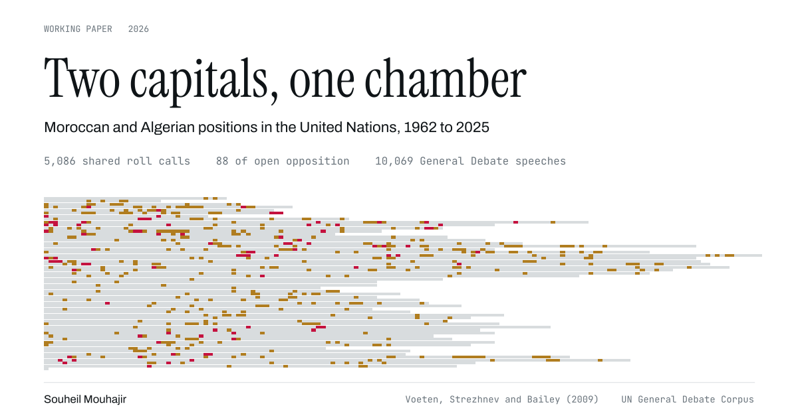

<!-- markdownlint-disable MD033 MD041 -->
<p align="center">
  
</p>

<h1 align="center">Two capitals, one chamber</h1>

<p align="center">
  Moroccan and Algerian positions in the United Nations, 1962 to 2025<br>
  <a href="https://souheil-mouhajir.github.io/two-capitals-one-chamber/"><b>Read the working paper</b></a> &middot;
  <a href="data/processed/">Data</a> &middot;
  <a href="#reproducing-the-paper">Reproduce</a>
</p>

<p align="center">
  
  
  
  
</p>

---

Morocco and Algeria keep no embassies in each other's capitals and have kept the land
border shut since 1994. In the UN General Assembly they cast the same ballot on
95.5 percent of roll calls since 2000. This project codes every shared vote, scales both
states on the Assembly's main dimension, measures their defection from their own caucuses,
tracks the Sahara file across two chambers, and reads their General Debate speeches, to
find where the rivalry actually surfaces.

## Three findings

**The split appears only where the stakes are named.** On the roll calls the US State
Department designates as important, Morocco agrees with Washington 10.9 points more often
than Algeria does, with a 95 percent bootstrap interval of 7.0 to 15.2 over 201 votes. The
sign turns over toward Beijing at -11.5 points and Moscow at -12.0. On the full agenda the
same differences run between 1.5 and 3.3 points.

**The two positions converged after the Cold War and have separated again.** On the first
dimension of the yearly vote matrix the distance between them was 0.60 in 1962-1975
(interval 0.46 to 0.73), fell to -0.01 in 1992-2005 with an interval of -0.05 to 0.05 that
contains zero, and reopened to 0.14 in 2006-2019.

**Open opposition is rare and concentrated.** Across 5,086 shared roll calls the two voted
yes against no exactly 88 times, 23 of them since 1990. The recent cases sit on two files:
the annual resolution on the Declaration on the Granting of Independence, which carries
Western Sahara under its plenary name and which Morocco has voted against every year since
2015, and the Syria human rights texts.

## What the page holds

| Section | What it shows |
| --- | --- |
| Position | Yearly scaling of Morocco, Algeria and the United States, with bootstrap intervals on the distance, and a playable beeswarm of all 190 states |
| Divergence | Agreement differences toward six capitals with 95 percent intervals, for important votes and for the full agenda |
| Caucus | Defection from the Arab League and the African group, a measure built here rather than borrowed |
| Sahara | The 25 roll calls naming the territory and the 68 Declaration votes that replaced them, with the chamber tally |
| MINURSO | The 12 Security Council renewals from 2016 to 2025, the layer the Assembly record cannot reach |
| Opposition | Every one of the 88 opposed roll calls, linked to a barcode of all 5,086 shared ballots |
| Rhetoric | Term rates and TF-IDF similarity across 10,069 General Debate addresses |
| Explorer | The agreement series for any capital, any subject coding, and either similarity measure |

The chamber beeswarm keeps one node per state and tweens positions between years, so the play control reads as motion rather than as a slideshow. Charts fade on redraw, filters wait 120 ms for typing to settle, and every transition drops out under `prefers-reduced-motion`.

## Data sources

| Layer | Source | Coverage | Licence |
| --- | --- | --- | --- |
| Roll calls | Voeten, Strezhnev and Bailey (2009), [doi:10.7910/DVN/LEJUQZ](https://doi.org/10.7910/DVN/LEJUQZ), packaged by [Robinson's unvotes](https://github.com/dgrtwo/unvotes) | 1962 to 2020, sessions 17 to 74 | CC0 |
| Speeches | Mikhaylov, Baturo and Dasandi (2017), [doi:10.7910/DVN/0TJX8Y](https://doi.org/10.7910/DVN/0TJX8Y), text files from [this mirror](https://github.com/nicolasdz/UNGDC) | 1962 to 2024, 10,069 addresses | CC0 |
| Council votes | [UNSCR](https://unscr.com/), an unofficial compilation not affiliated with the United Nations | 2016 to 2025, 12 renewals | see `data/manual/README.md` |

The three layers end in different years, and the page says so on the first screen. Sessions
75 to 79 of the roll call file sit in the Dataverse release, which this build does not fetch.

## Continuous integration

The workflow in `.github/workflows/check.yml` runs both suites on every push and deploys
`docs/` to Pages. Once it has run green once on `main`, this line restores the status badge
at the top of the file:

```markdown

```

The badge endpoint does not exist before the first run, which is why it is not there yet.

## Publishing

Every copy of the paper carries its own payload, so none of them depends on a second
request and all of them open from disk with no server. `index.html` at the root serves a
Pages site configured on the branch root, `docs/index.html` serves one configured on the
docs folder and is what the included workflow deploys, and `dist/` holds the same file under
a descriptive name for sending by hand. `data.json` sits beside the docs build as a
download, not as a dependency.

In Settings, Pages, either option now resolves to the paper: "Deploy from a branch" with
`main` and `/ (root)`, "Deploy from a branch" with `main` and `/docs`, or "GitHub Actions".

## Reproducing the paper

```bash
git clone https://github.com/souheil-mouhajir/two-capitals-one-chamber
cd two-capitals-one-chamber
pip install -r requirements.txt
make all        # fetch, build, test, render, check
```

`make all` runs the five stages below. The full run takes roughly fifteen minutes, almost
all of it in the 200 bootstrap replications per year and the 300 per period. Random draws
are seeded at 20260901, so the intervals come back identical.

| Stage | Command | Writes |
| --- | --- | --- |
| Fetch | `make fetch` | `data/raw/` (420 MB, never committed) |
| Roll calls | `python3 src/build_votes.py` | agreement cells, splits, Sahara tables, barcode |
| Positions | `python3 src/build_positions.py` | scaling, periods, gaps, chamber |
| Speeches | `python3 src/build_speech.py` | term counts, TF-IDF similarity |
| Page | `python3 src/build_site.py` | `docs/index.html`, `docs/data.json`, `dist/` |
| Cards | `python3 src/build_figures.py` | `figures/`, `docs/assets/og-image.png` |

Two test suites guard the result. `python3 src/test_data.py` asserts the 30 claims the prose makes, including the roll call count, the sign of every interval and the vocabulary ratios.
`node src/check_site.js` loads the standalone build in jsdom and checks that all nine
figures draw, all five tables fill, every control fires and the console stays clean.

## Repository layout

```
src/                 pipeline, templates and tests
  common.py            paths, palette, weights, bloc rosters
  build_votes.py       roll call layer
  build_positions.py   scaling and bootstrap intervals
  build_speech.py      General Debate layer
  build_site.py        assembles docs/ and dist/
  build_figures.py     static cards
  test_data.py         integrity tests
  check_site.js        headless page tests
  templates/           index.html, style.css, app.js
data/
  raw/                 downloaded inputs, gitignored
  manual/              the one hand entered file, with its provenance note
  processed/           nine published CSVs
docs/                  GitHub Pages build, index.html plus data.json
dist/                  single file build, 360 KB, opens offline
figures/               social cards and the link preview
```

## Data dictionary

Every processed file is documented in [`data/processed/README.md`](data/processed/README.md).
The two files most people want are `agreement_by_year.csv`, which carries the agreement
index for thirteen dyads under eight subject codings, and `opposed_roll_calls.csv`, which
lists the 88 votes with their resolution symbols.

## Method in one paragraph

The agreement index scores a shared roll call 1 for the same ballot, 0.5 when one abstains
and the other votes yes or no, and 0 for opposition, following Bailey et al. (2017). The
page also offers a chance corrected version, which applies those weights to Cohen's (1960)
kappa using each state's own ballot shares as the baseline, answering Häge's (2011)
objection that raw similarity rewards states for voting the way almost everyone votes.
Positions come from the first left singular vector of the column centred vote matrix, with
yes coded 1, abstain 0.5 and no 0, scaled to unit standard deviation and signed so that the
United States is positive. Intervals resample roll calls with replacement and realign each
replicate to the point estimate by sign.

## Limits

The scaling is estimated separately in each year and period, so levels compare within a
panel and not across them, unlike the dynamic model of Bailey et al. (2017). Bloc membership
uses current rosters, so the caucus measure applies today's borders to earlier decades. The
Sahara table is built by string matching on the resolution record and will miss votes filed
under other titles. Member level attribution for the MINURSO renewals is not in this build,
because the source publishes the tally and the Council roster without the mapping.

## Citation

```bibtex
@misc{mouhajir2026twocapitals,
  author = {Mouhajir, Souheil},
  title  = {Two capitals, one chamber: Moroccan and Algerian positions in the United Nations, 1962-2025},
  year   = {2026},
  note   = {Interactive working paper},
  url    = {https://souheil-mouhajir.github.io/two-capitals-one-chamber/}
}
```

## Licence

Code under [MIT](LICENSE). The processed data and the figures under
[CC BY 4.0](data/processed/LICENSE). The underlying roll call and speech corpora carry their
own terms, listed in the sources table above.
